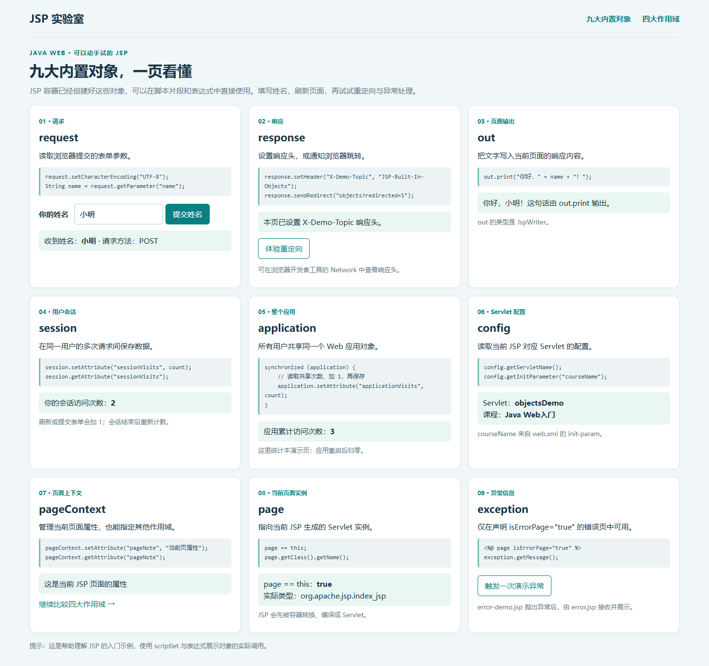
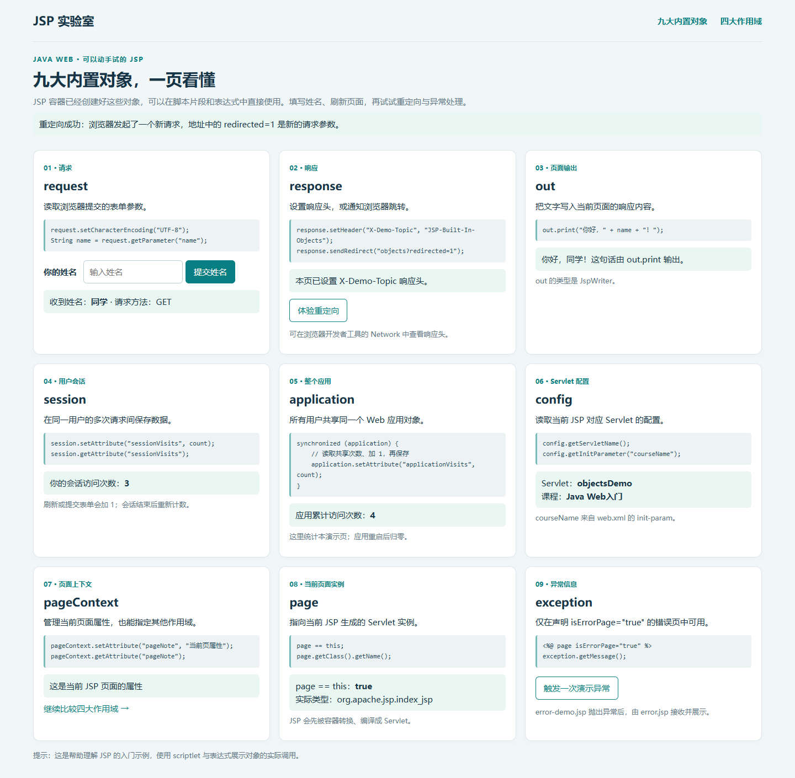
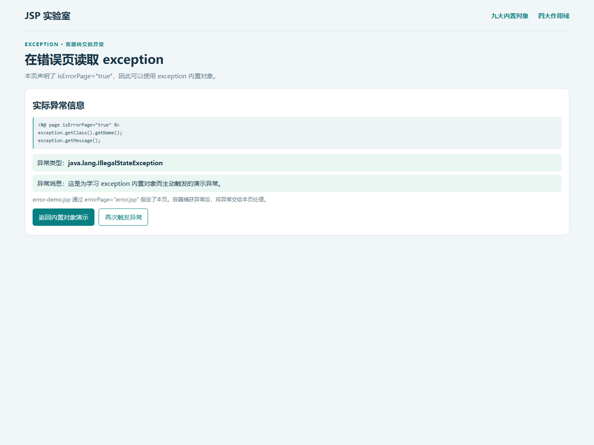
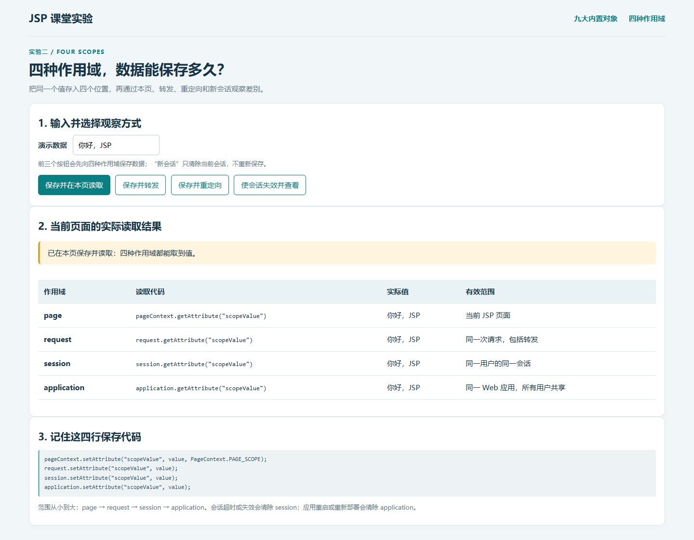
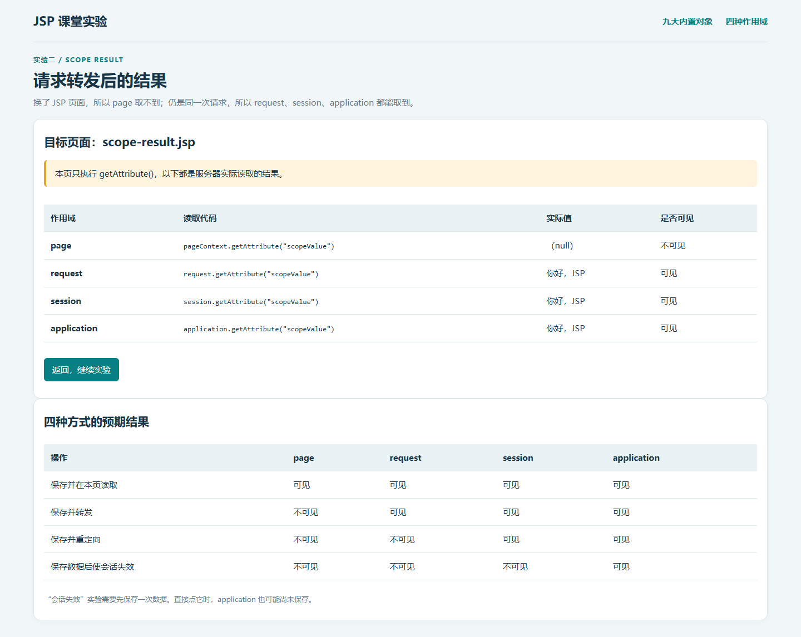
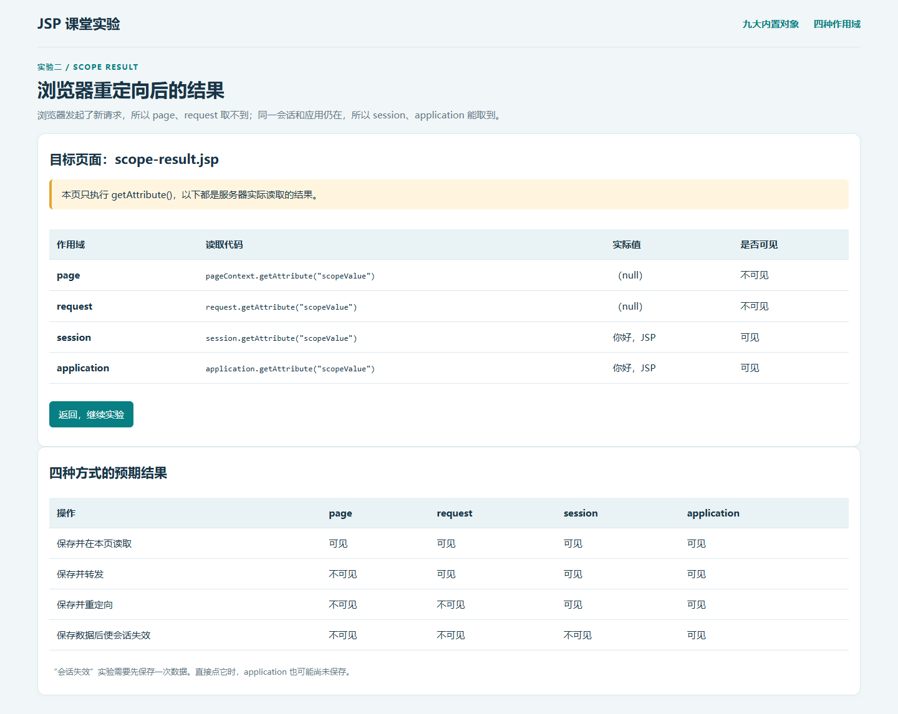
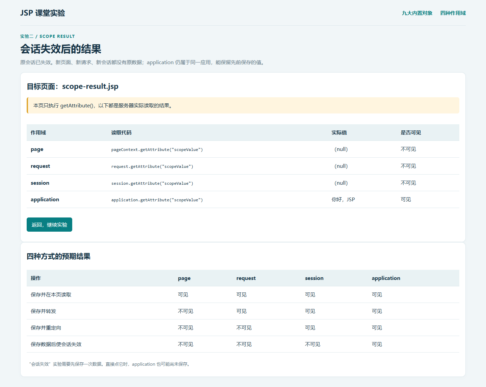

# JSP 九大内置对象与四种作用域演示

Java Web 初学者作业。使用原生 JSP、简单 Java 脚本片段和表达式，关键代码都有中文注释。

## 1. 运行方法

### 方法一：Windows 一键运行

1. 先安装 JDK，推荐 JDK 17 或 21。
2. 下载本仓库并解压，双击 `run.bat`。
3. 第一次启动会从 Apache 官方下载 Tomcat 9.0.123，并校验 SHA-512，因此需要联网。
4. 控制台出现服务器启动完成后，打开 <http://localhost:18080/jsp-demo/objects>。
5. 保持控制台开启；实验结束按 `Ctrl+C` 停止。

如果找不到 Java，在项目目录打开 PowerShell，指定自己的 **JDK 安装目录**：

```powershell
powershell.exe -NoProfile -ExecutionPolicy Bypass -File .\run.ps1 -JavaHome "C:\Program Files\Java\jdk-21"
```

端口被占用时，可以加上 `-Port 18090`，访问地址也改为 `18090`。

### 方法二：已有 Tomcat 9

把 `dist/jsp-demo.war` 复制到 Tomcat 9 的 `webapps` 目录，启动 Tomcat 后访问：

```text
http://localhost:8080/jsp-demo/objects
```

这里的 `8080` 要替换成你自己的 Tomcat 端口。也可以把 `src/main/webapp` 文件夹的**全部内容**复制到 `webapps/jsp-demo`。修改源码后需要重新复制，或者重新生成 WAR。

本项目按 Tomcat 9（JSP 2.3 / `javax`）编写和验证。

## 2. 文件怎么读

```text
src/main/webapp/
├── index.jsp                 九大内置对象演示，入口为 /objects
├── response-demo.jsp         response 设置响应头并重定向
├── error-demo.jsp            主动抛出异常
├── error.jsp                 用 exception 读取异常
├── scopes.jsp                保存四种作用域数据，选择实验方式
├── scope-result.jsp          只读取作用域数据的目标页面
├── style.css                 简单页面样式
└── WEB-INF/
    ├── web.xml               入口映射、config 初始化参数、会话超时
    └── jspf/functions.jspf    h()：转义动态文字
screenshots/                  7 张实际运行截图
dist/jsp-demo.war             可直接部署的 Web 应用
run.bat / run.ps1             Windows 启动入口与辅助脚本
verification.json             实际运行检查记录
```

学习时先看 6 个 JSP 文件，启动脚本只是帮助运行环境。

## 3. 九大内置对象

内置对象由 JSP 容器提供，不需要自己 `new`。

| 对象 | 作用 | 本作业中的实际演示 |
| --- | --- | --- |
| request | 读取本次请求数据 | 输入姓名，用 `request.getParameter("name")` 读取 |
| response | 控制响应 | 设置 `X-Demo-Topic` 响应头；点击按钮发送 302 重定向 |
| out | 输出页面内容 | 用 `out.print()` 输出问候语 |
| session | 保存同一会话的数据 | 保存本用户的访问次数 |
| application | 保存整个应用的共享数据 | 保存所有用户的累计访问次数 |
| config | 读取当前 Servlet 配置 | 显示 Servlet 名和 `web.xml` 中的 `courseName` |
| pageContext | 管理页面上下文和属性 | 保存、读取当前页的 `pageNote` |
| page | 当前 JSP 对应的 Servlet 实例 | 显示 `page == this` 和实际类名 |
| exception | 读取错误页收到的异常 | 真正抛出异常后，在 `error.jsp` 中读取类型与消息 |

`exception` 需要在声明了 `isErrorPage="true"` 的 JSP 中使用。普通页面通过 `errorPage="error.jsp"` 指定错误处理页面。

### 最容易理解的例子

```jsp
<%
    request.setCharacterEncoding("UTF-8");
    String name = request.getParameter("name");
    session.setAttribute("name", name);
%>
```

第一行设置中文编码，第二行读取表单参数，第三行把姓名保存到会话中。项目显示输入时使用 `h()` 转义，避免把输入当成 HTML 标签。

`getParameter()` 读取表单或 URL 参数；`getAttribute()` 读取代码用 `setAttribute()` 保存的属性，两者不同。

## 4. 四种作用域

**作用域**就是数据在哪些页面、哪些请求、哪些用户之间仍然可用。

范围从小到大：`page → request → session → application`。

```jsp
<%
    pageContext.setAttribute("scopeValue", value, PageContext.PAGE_SCOPE);
    request.setAttribute("scopeValue", value);
    session.setAttribute("scopeValue", value);
    application.setAttribute("scopeValue", value);
%>
```

打开“四种作用域”，按下面顺序观察：

| 操作 | page | request | session | application |
| --- | --- | --- | --- | --- |
| 保存并在本页读取 | 有值 | 有值 | 有值 | 有值 |
| 保存并转发到另一个 JSP | 无值 | 有值 | 有值 | 有值 |
| 保存并重定向到另一个 JSP | 无值 | 无值 | 有值 | 有值 |
| 保存后使会话失效，再访问目标页 | 无值 | 无值 | 无值 | 有值 |

- `page`：只在当前 JSP 的本次执行中有效。
- `request`：在同一次请求中有效，服务器内部转发仍属于这次请求。
- `session`：同一会话的多次请求之间有效；本项目超时设置为 30 分钟不活动，或点击按钮立即失效。
- `application`：同一个 Web 应用中的用户共享；应用重启或重新部署后清除。

**转发**使用 `pageContext.forward()`，由服务器内部完成，浏览器地址通常不变。**重定向**使用 `response.sendRedirect()`，浏览器会再发起一次新请求，地址随之改变。

目标页 `scope-result.jsp` 只调用 `getAttribute()`，因此可以真实观察哪些值保留下来。“使会话失效”前请先保存一次数据。

同一浏览器的普通标签页通常共享会话 Cookie；要比较不同用户，可以使用另一个浏览器或独立的无痕会话。

## 5. 实际运行截图

以下截图由 Chrome 无头浏览器访问真正运行的 Tomcat / JSP 页面生成，姓名使用演示数据“小明”。截图测试端口为 `18081`；默认启动端口为 `18080`。截图中的访问次数会随刷新而变化。

### 九大对象与中文表单



### response 重定向成功



### exception 错误页



### 四种作用域：本页读取



### 四种作用域：转发



### 四种作用域：重定向



### 四种作用域：会话失效



## 6. 验证记录

2026-10-21，JDK 21.0.5 + Apache Tomcat 9.0.123，已实际验证：

- JSP 编译、九对象展示、中文 POST 表单、config 初始化参数和 page 实例。
- response 自定义响应头和真实 HTTP 302 重定向。
- 真实异常及错误页中的 exception。
- 本页、转发、重定向、会话失效四组作用域结果。
- 两个独立浏览器会话的 session 隔离、application 共享。
- HTML 特殊字符以文字形式显示。

访问数据使用内存属性保存。应用重启后清空，适合观察作用域的生命周期。

参考：[Tomcat 官方下载](https://tomcat.apache.org/download-90.cgi)、[PageContext 官方 API](https://tomcat.apache.org/tomcat-9.0-doc/jspapi/javax/servlet/jsp/PageContext.html)。
